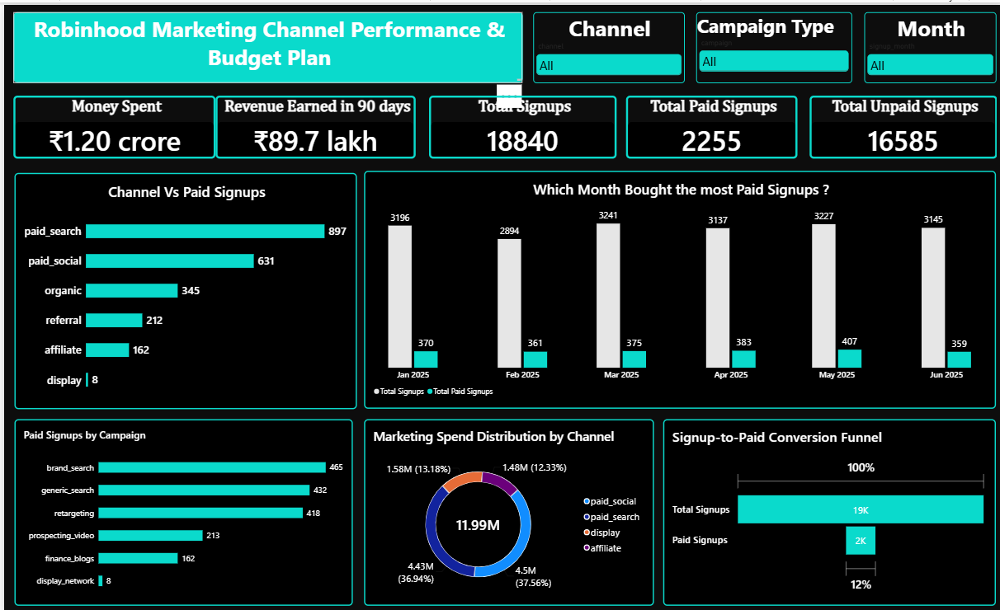
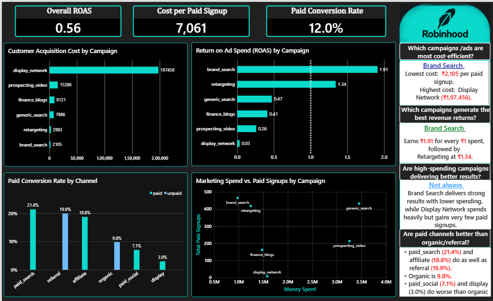
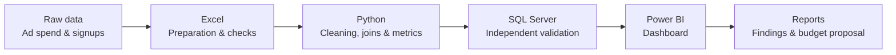

<div align="center">

# Robinhood Marketing Channel Performance & Budget Optimization

**A data analytics case study on customer acquisition efficiency, paid conversion, and marketing budget allocation**

<br>


</div>

---

## Project Overview

This project evaluates marketing channel performance for a Robinhood-based practice case study covering **January–June 2025**. The analysis connects advertising spend and signup data to understand which channels generate paying customers efficiently—and how the next budget cycle could be allocated.

The central business question:

> **Which marketing channels acquire customers efficiently, and where should the next budget be invested?**

Using Python, SQL Server, Excel, and Power BI, I cleaned and validated the data, calculated acquisition and revenue metrics, compared channel performance, and developed a proposed budget allocation.

> **Dataset note:** This is a practice case study based on Data Career School material. It should not be interpreted as an official Robinhood analysis or company-endorsed recommendation.

## Executive Summary

The analysis highlights a key distinction between acquiring signups and acquiring paying customers: **a low cost per signup does not necessarily translate into efficient customer acquisition.**

For example, prospecting video and retargeting generated signups at similar costs, but their conversion to paying customers differed considerably.

| Metric | Prospecting video | Retargeting |
|---|---:|---:|
| Cost per signup | ₹507 | ₹509 |
| Signups | 6,484 | 2,465 |
| Paying customers | 213 | 418 |
| Signup-to-paid conversion | 3% | 17% |
| Cost per paying customer | ₹15,286 | ₹2,983 |

**Key takeaway:** Evaluate channels using the cost of acquiring a paying customer—not signup cost alone.

## Business Findings

### Channel performance

| Channel | Cost per paying customer | Revenue per ₹1 spent* | Recommendation |
|---|---:|---:|---|
| Brand search | ₹2,105 | ₹1.91 | Increase cautiously |
| Retargeting | ₹2,983 | ₹1.34 | Increase cautiously |
| Generic search | ₹7,986 | ₹0.47 | Maintain and monitor |
| Finance blogs | ₹9,122 | ₹0.41 | Maintain and monitor |
| Prospecting video | ₹15,286 | ₹0.26 | Reduce |
| Display network | ₹1,97,456 | ₹0.03 | Pause |

\*Revenue per ₹1 spent is based on the project's 90-day revenue window. Amounts are shown in INR using the example conversion rate of ₹96 per USD.

Only brand search and retargeting generated more than ₹1 in 90-day revenue per ₹1 spent in this analysis.

### Proposed budget allocation

The proposed allocation shifts investment toward channels with stronger observed acquisition efficiency and introduces a test reserve.

| Channel | Existing allocation | Proposed allocation |
|---|---:|---:|
| Generic search | 29% | 30% |
| Retargeting | 10% | 20% |
| Brand search | 8% | 15% |
| Prospecting video | 27% | 15% |
| Finance blogs | 12% | 12% |
| Test reserve | 0% | 8% |
| Display network | 13% | 0% |

**Scenario estimate:** The proposed plan could increase paying signups from **2,255 to approximately 3,050 (+35%)**. This is a model-based estimate, not a guaranteed outcome; actual results may differ as channel budgets and audience saturation change.

## Dashboard

The Power BI report is organized into two pages:

| Executive overview | Channel comparison |
|---|---|
|  |  |

The dashboard supports review of overall performance, channel-level acquisition efficiency, and trends across the analysis period.

## Key Metrics

| Metric | Result |
|---|---:|
| Advertising spend | ₹1.20 crore |
| Revenue attributed within 90 days | ₹89.7 lakh |
| Signups that converted to paid | 2,255 |
| Signups that did not convert to paid | 16,585 |
| Paid conversion rate | 12% |

Additional observations:
- Paid search generated the highest number of paying signups (897).
- March recorded the highest signup volume (3,241).
- May recorded the highest number of paying signups (407).
- Display network activity ended after May.
- Paid search, referral, and affiliate channels had stronger signup-to-paid conversion than display.

## Analytical Workflow



1. **Data quality checks:** identified and removed 7 repeated spend rows, standardized channel names, and reviewed signup source categories.
2. **Data preparation:** cleaned the data and prepared channel-level summaries before joining datasets.
3. **Metric development:** calculated click rate, cost per click, cost per signup, cost per paying customer, paid conversion rate, and ROAS.
4. **SQL validation:** reproduced key aggregations and joins in SQL Server to cross-check Python outputs.
5. **Visualization:** built a two-page Power BI dashboard to communicate channel and trend performance.
6. **Recommendation:** translated the analysis into a proposed budget mix and documented assumptions.

## Tools & Skills

| Area | Tools / techniques |
|---|---|
| Data preparation | Excel, pandas, data cleaning, duplicate checks |
| Analysis | Python, pandas, metric calculations |
| Querying | SQL Server, SQL queries, GROUP BY, JOIN, CASE, temporary tables, date functions  |
| Business metrics | CTR, CPC, cost per signup, cost per paying customer, conversion rate, ROAS |
| Visualization | Power BI, KPI cards, trend charts, channel comparisons |
| Communication | Analytical reporting, insight development, budget recommendations |

## Project Structure

```text
robinhood-marketing-analysis/
├── README.md
├── python/
│   ├── Python_Analysis.ipynb
│   └── campaign_metrics.csv
├── sql/
│   └── SQLQuery.sql
├── powerbi/
│   ├── Powerbi_Analysis.pbix
│   ├── dashboard_page1.png
│   └── dashboard_page2.png
├── docs/
│   ├── Python_Analysis_Report.pdf
│   ├── SQL_Analysis.docx
│   ├── Python_QA_Document.pdf
│   ├── Research_and_Conclusion.pdf
│   └── budget_split_before_after.png
└── data/
    └── README.md
```

## Limitations & Assumptions

- Revenue is evaluated only within the first 90 days; longer-term customer value is not captured.
- Some brand-search conversions may have occurred without advertising.
- Brand search and retargeting have limited audience pools; increasing spend may reduce efficiency.
- Each signup is attributed to a single channel.
- The analysis describes observed associations and does not establish causal impact.
- The budget proposal is directional and should be validated through controlled experiments and ongoing monitoring.

## Reproducing the Analysis

The raw data files are not included in this repository.

1. Obtain `ad_spend.csv` and `signups.csv` from the Data Career School project materials.
2. Follow the instructions in `data/README.md` to prepare the source tables.
3. Open `python/Python_Analysis.ipynb` in Jupyter and run **Kernel → Restart & Run All**.
4. Execute `sql/SQLQuery.sql` in SQL Server Management Studio after loading the tables.
5. Open `powerbi/Powerbi_Analysis.pbix` in Power BI Desktop.

## About

**Neha Shinge**  
Data Analytics | Business Intelligence | Marketing Analytics

- [LinkedIn](YOUR_LINKEDIN_URL)
- [GitHub](YOUR_GITHUB_URL)
- Email: YOUR_EMAIL
